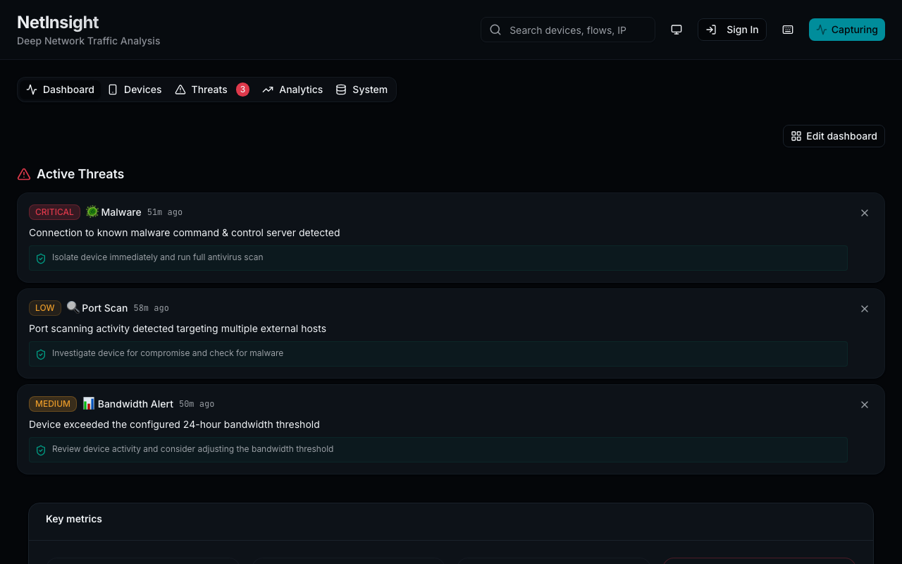

# NetInsight - Deep Network Analysis

**A network traffic analysis dashboard for your home network — packet capture on a Raspberry Pi 5, UI on Cloudflare Pages.**

[](https://github.com/and3rn3t/net-traffic/actions/workflows/ci-cd.yml)
[](LICENSE)



## 🚀 Features

- Real-time network traffic monitoring
- Advanced analytics and visualization
- Geographic distribution mapping
- Protocol breakdown and analysis
- Security posture monitoring
- Anomaly detection

## 🏗️ Architecture

**Frontend**: Deployed to Cloudflare Pages (CDN, global distribution)  
**Backend**: Runs on Raspberry Pi 5 (packet capture, database, API)

This architecture simplifies deployment and improves performance by serving the frontend from Cloudflare's edge network while keeping the backend on your local Raspberry Pi for packet capture and data processing.

> 📖 **Deployment Guide**: See [docs/DEPLOYMENT.md](docs/DEPLOYMENT.md) for Cloudflare Pages, the tunnel, and configuration.

## 🛠️ Getting started

### Prerequisites

- Node.js 24.13 or higher (see `.nvmrc`)
- npm or yarn

### Setup

```bash
# Install dependencies
npm install

# Start development server
npm run dev

# Build for production
npm run build

# Preview production build
npm run preview
```

## ⚙️ Environment Configuration

The application uses environment variables to configure API connections and behavior.

### Environment Variables

Create a `.env` file in the project root (see `.env.example` for a template):

```env
# Enable/disable real API mode
# Set to 'true' to connect to backend API, 'false' to use mock data
VITE_USE_REAL_API=false

# Backend API Base URL
# Default: http://localhost:8000
# For Raspberry Pi: http://<raspberry-pi-ip>:8000
VITE_API_BASE_URL=http://localhost:8000
```

### Environment Variable Reference

| Variable            | Description                                   | Default                 | Required |
| ------------------- | --------------------------------------------- | ----------------------- | -------- |
| `VITE_USE_REAL_API` | Enable real backend API mode (`true`/`false`) | `false`                 | No       |
| `VITE_API_BASE_URL` | Backend API server URL                        | `http://localhost:8000` | No       |

### Validation

Validate your environment configuration:

```bash
npm run validate:env
```

This script will:

- Check that all environment variables are set correctly
- Validate URL formats
- Warn about missing or incorrect configurations
- Provide setup tips

### Usage Modes

**Mock Data Mode (Default):**

- Set `VITE_USE_REAL_API=false` or omit the variable
- Application uses generated mock data
- Works completely offline
- Useful for development and testing UI

**Real API Mode:**

- Set `VITE_USE_REAL_API=true`
- Set `VITE_API_BASE_URL` to your backend server URL
- Connects to Raspberry Pi 5 backend or local backend
- Requires backend to be running
- Provides real-time data via WebSocket

### Example Configurations

**Local Development (Mock Data):**

```env
VITE_USE_REAL_API=false
```

**Local Development (Backend on same machine):**

```env
VITE_USE_REAL_API=true
VITE_API_BASE_URL=http://localhost:8000
```

**Raspberry Pi Backend:**

```env
VITE_USE_REAL_API=true
VITE_API_BASE_URL=http://192.168.1.100:8000
```

## 📦 Deployment

### Architecture

**Frontend**: Deployed to Cloudflare Pages (CDN, global distribution)  
**Backend**: Runs on Raspberry Pi 5 (packet capture, database, API, all processing)

This architecture simplifies deployment and improves performance by serving the frontend from Cloudflare's edge network while keeping **all backend components** (database, packet capture, processing) on your local Raspberry Pi for optimal privacy, performance, and cost.

**Why keep everything on Pi?**

- **Packet Capture**: Requires direct network interface access (cannot run on Cloudflare)
- **Database**: Privacy (data stays local), performance (<1ms vs 100-500ms), cost ($0 vs egress fees)
- **Real-time Processing**: Needs low latency for immediate packet analysis
- See [docs/ARCHITECTURE.md](docs/ARCHITECTURE.md) for detailed analysis

### Cloudflare Pages Deployment

Every push to `main` runs CI, builds `dist/` with the `VITE_*` GitHub secrets, and uploads it
to the `net-traffic` Pages project with wrangler (PRs don't get preview deployments). Manual
deploy: `npm run deploy:cloudflare`. Setup, secrets and troubleshooting are in
[docs/DEPLOYMENT.md](docs/DEPLOYMENT.md).

## 🧪 Testing

The project uses a comprehensive testing strategy:

- **Unit Tests**: Run on every push and PR (must pass for deployment)
- **E2E Tests**: Run on push to main/master with 4 workers for fast parallel execution
  - Don't block deployment if they fail (results still saved)
  - Not run on PRs to save CI time
- **Nightly Tests**: Full test suite runs every night at 2 AM UTC

See [docs/TESTING_STRATEGY.md](docs/TESTING_STRATEGY.md) for complete testing documentation.

## 📚 Documentation

### Running it

- **[DEPLOYMENT_RASPBERRY_PI.md](./docs/DEPLOYMENT_RASPBERRY_PI.md)** - Pi 5 install: OS prep, venv, systemd, network config
- **[DEPLOYMENT.md](./docs/DEPLOYMENT.md)** - Cloudflare Pages, Cloudflare Tunnel, frontend/backend configuration
- **[CAPTURE.md](./docs/CAPTURE.md)** - Getting traffic to the Pi, how capture works, what's extracted
- **[ADVANCED_IDENTIFICATION_CONFIG.md](./docs/ADVANCED_IDENTIFICATION_CONFIG.md)** - Tuning device hostname/vendor/type identification
- **[TROUBLESHOOTING.md](./docs/TROUBLESHOOTING.md)** - Backend service and packet-capture problems
- **[USER_GUIDE.md](./docs/USER_GUIDE.md)** - Using the dashboard: tabs, filters, search, export
- **[scripts/README.md](./scripts/README.md)** - What every helper script does

### Developing

- **[AGENTS.md](./AGENTS.md)** - Architecture, commands and conventions for AI agents and developers
- **[ARCHITECTURE.md](./docs/ARCHITECTURE.md)** - Topology and why processing stays on the Pi
- **[DATABASE_SCHEMA.md](./docs/DATABASE_SCHEMA.md)** - Tables, and the two places schema is defined
- **[TESTING_STRATEGY.md](./docs/TESTING_STRATEGY.md)** - Test layers, workflows and setup
- **[E2E Tests Guide](./tests/e2e/README.md)** - Playwright E2E testing guide

### Planning

- **[ROADMAP.md](./docs/ROADMAP.md)** - Shipped features and backlog, by priority
- **[PRD.md](./docs/PRD.md)** - Product requirements

## 🧰 Tech stack

- **Frontend**: React 19 + TypeScript + Vite, Tailwind CSS 4, shadcn/ui, TanStack Query, Recharts — deployed to Cloudflare Pages
- **Backend** (`backend/`): Python, FastAPI, aiosqlite, Scapy — runs on a Raspberry Pi 5
- **Tests**: Vitest + Testing Library, Playwright, pytest

## 📁 Project Structure

```text
├── src/
│   ├── components/     # React components
│   ├── lib/           # Utilities and types
│   ├── hooks/         # Custom React hooks
│   └── styles/        # CSS styles
├── .github/
│   ├── workflows/        # GitHub Actions workflows
│   └── ISSUE_TEMPLATE/   # Issue templates
├── .vscode/              # VS Code workspace settings
├── src/                  # Source code
└── vite.config.ts        # Vite build configuration
```

## 🔧 Configuration

- `vite.config.ts`: Vite build settings
- `eslint.config.js`: ESLint configuration
- `.prettierrc.json`: Prettier formatting rules
- `.github/workflows/`: CI/CD pipelines

## 📄 License

[MIT](LICENSE). The Spark Template files and resources from GitHub are licensed under the terms of the MIT license, Copyright GitHub, Inc.
